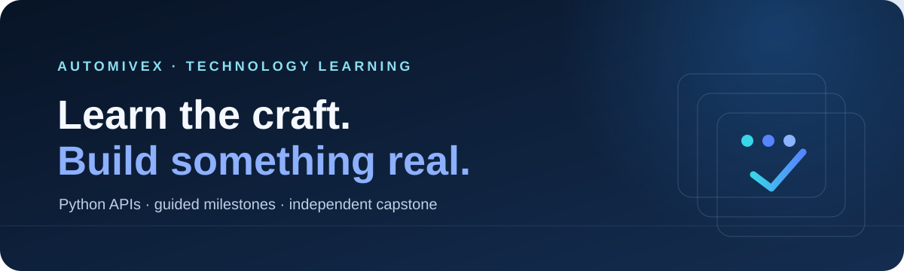
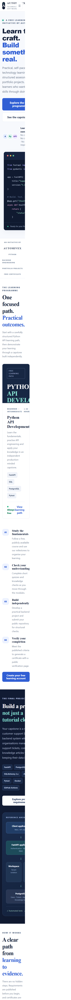
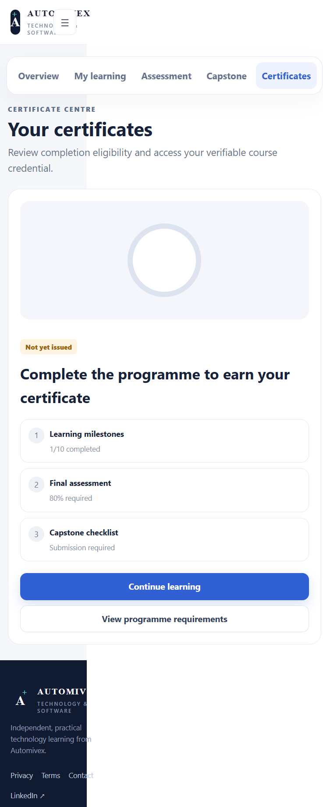
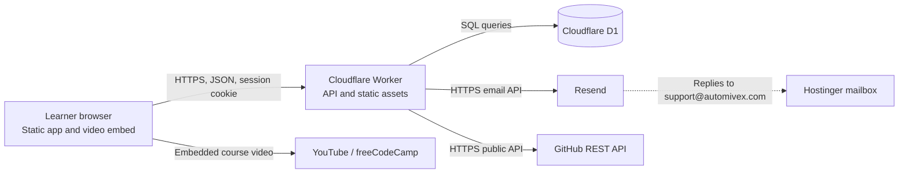

<p align="center">
  
</p>

<p align="center">
  <a href="https://github.com/Attayab-31/Automivex-Learning-Platform">
    
  </a>
  
  
</p>

<p align="center">
  <a href="#overview">Overview</a> ·
  <a href="#features">Features</a> ·
  <a href="#architecture">Architecture</a> ·
  <a href="#quickstart">Quickstart</a> ·
  <a href="#api">API</a> ·
  <a href="#security-and-limitations">Security</a> ·
  <a href="#contact-and-community">Contact</a>
</p>

<p align="center">
  <a href="https://twitter.com/intent/tweet?text=Explore%20Automivex%20Learning%20Platform&url=https%3A%2F%2Fgithub.com%2FAttayab-31%2FAutomivex-Learning-Platform"></a>
  <a href="https://www.linkedin.com/sharing/share-offsite/?url=https%3A%2F%2Fgithub.com%2FAttayab-31%2FAutomivex-Learning-Platform"></a>
  <a href="https://www.facebook.com/sharer/sharer.php?u=https%3A%2F%2Fgithub.com%2FAttayab-31%2FAutomivex-Learning-Platform"></a>
  <a href="https://www.reddit.com/submit?url=https%3A%2F%2Fgithub.com%2FAttayab-31%2FAutomivex-Learning-Platform&title=Automivex%20Learning%20Platform"></a>
  <a href="https://wa.me/?text=Explore%20Automivex%20Learning%20Platform%3A%20https%3A%2F%2Fgithub.com%2FAttayab-31%2FAutomivex-Learning-Platform"></a>
</p>

<p align="center">
  <a href="https://github.com/Attayab-31/Automivex-Learning-Platform">⭐ Star this repository</a> ·
  <a href="https://github.com/Attayab-31/Automivex-Learning-Platform/issues">Report an issue</a>
</p>

## Overview

Automivex Learning Platform is a self-paced learning site for **Python API Development**. It combines structured study milestones, knowledge checks, a server-graded assessment, and an independent portfolio capstone brief.

The site and API are implemented as a Cloudflare Worker with static assets and a Cloudflare D1 database. Learners can register using email one-time codes, track progress, submit a public GitHub repository for a structural checklist, and—after the published requirements and administrator review—receive a verifiable course-completion certificate.

> This is an educational programme, not an internship, job offer, paid placement, or accredited qualification. The capstone brief describes a separate portfolio project; it is not implemented as part of this learning platform.

## Features

### Implemented

- Responsive landing page, learner workspace, privacy notice, terms, and certificate verification page.
- Email OTP registration and sign-in; local development can return a debug code when SMTP is not configured.
- Learner enrolment, ordered lesson milestones, and progress stored in D1.
- Server-graded final assessment with randomized question and choice order, written evidence, and a passing score threshold.
- GitHub public repository metadata and file-structure checks, plus administrator review controls.
- Certificate eligibility checks, issuance, and public verification.
- Account deletion and administrator overview.
- Branded wordmarks, favicon, theme support, and loading screen.

### External services and honest boundaries

| Service | Used for | Important boundary |
|---|---|---|
| Cloudflare Workers and D1 | Hosting, API, and persistent application data | Usage limits and prices depend on Cloudflare’s current plans. |
| Resend | Sending sign-in codes through its HTTPS email API | Requires a verified sending domain and API key; plan limits apply. Replies to `support@automivex.com` are received by the existing Hostinger mailbox. |
| GitHub REST API | Inspecting public capstone repository metadata and tree contents | The checker does not run submitted code or perform a code review. |
| YouTube | External freeCodeCamp learning video | The video is third-party content and is not hosted by this project. |
| LinkedIn, YouTube, TikTok | Learner links and capstone attestations | Follow/subscription confirmations are self-reported, not verified by those platforms. |

## Screenshots and demo

The repository includes mobile screenshots of the landing page and learner certificate area.

<details>
  <summary>View mobile screenshots</summary>

  <p align="center">
    
    &nbsp;&nbsp;
    
  </p>
</details>

No public demo deployment has been verified. Run the app locally using the [quickstart](#quickstart).

## Architecture



The browser sends same-origin API requests to the Worker. The Worker serves the static application, enforces route access, and reads or writes learner state in D1. OTP delivery uses Resend’s HTTPS API with the verified `automivex.com` sender; replies continue to the Hostinger mailbox. Capstone checks call GitHub’s public API. The embedded course video is served by YouTube.

## Technology stack

| Area | Technology |
|---|---|
| Front end | HTML, CSS, vanilla JavaScript |
| Application/API | Cloudflare Workers (JavaScript modules) |
| Database | Cloudflare D1 (SQLite-compatible) |
| Email | Resend HTTPS email API |
| Local development and deployment | Node.js, npm, Wrangler |
| Automated checks | JavaScript syntax checks and HTTP production-smoke tests |

## Project structure

| Path | Purpose |
|---|---|
| `public/` | Static single-page learning app, styles, legal pages, certificate page, and brand assets |
| `src/worker.js` | Worker API, authentication, course logic, GitHub checks, and certificate verification |
| `migrations/` | Ordered D1 schema and integrity migrations |
| `tests/production-smoke.mjs` | HTTP smoke checks against a running local Worker |
| `scripts/validate-deploy-config.mjs` | Production configuration preflight run before deployment |
| `docs/CAPSTONE_SPEC.md` | Independent HelpFlow capstone requirements |
| `docs/DEPLOYMENT_GUIDE.md` | Deployment and DNS safety checklist |
| `docs/assets/readme-banner.svg` | Accessible repository banner |
| `wrangler.jsonc` | Worker, asset, D1, and public environment configuration |
| `.dev.vars.example` | Safe local environment template; copy it to ignored `.dev.vars` |

## Quickstart

### Prerequisites

- Node.js 20 or newer and npm.
- Cloudflare account for local Wrangler development; production deployment also requires a D1 database.
- A verified Resend sending domain and API key if you want to test real OTP email delivery.

### Install and configure

```bash
npm ci
```

Copy the safe environment template:

```powershell
Copy-Item .dev.vars.example .dev.vars
```

On macOS/Linux, use `cp .dev.vars.example .dev.vars`.

Edit `.dev.vars` locally. Never commit it:

| Variable | Local example | Purpose |
|---|---|---|
| `ENVIRONMENT` | `development` | Enables the development-only debug OTP fallback. Never use in production. |
| `APP_URL` | `http://localhost:8787` | Local application URL. |
| `SESSION_SECRET` | Generate a random secret of at least 32 characters | Protects verification-code hashes and signs certificate evidence. |
| `RESEND_API_KEY` | Set a Resend API key in `.dev.vars` | Secret; never commit or paste into README/configuration. |
| `EMAIL_FROM` | `Automivex <support@automivex.com>` | Sender address at the verified `automivex.com` domain. |
| `ADMIN_EMAILS` | `you@your-domain.example` | Comma-separated addresses granted administrator role after email verification. |
| `LINKEDIN_URL` | Official profile URL | Public programme link. |
| `YOUTUBE_URL` | Official channel URL | Public programme link; needed for capstone submission. |
| `TIKTOK_URL` | Official profile URL | Public programme link; needed for capstone submission. |
| `GITHUB_ORG_URL` | Public GitHub profile or organization | Displayed as the code profile link. |
| `WHATSAPP_COMMUNITY_URL` | Leave blank until ready | Optional community invite link. |

Create the local D1 schema and start the Worker:

```bash
npm run db:local
npm run dev
```

Open <http://localhost:8787>. Without a Resend API key, development mode can return a debug OTP for local sign-in. Configure `RESEND_API_KEY` to test actual email delivery. Do not deploy development-mode behavior.

## API

All API routes are implemented in [`src/worker.js`](src/worker.js). JSON request bodies are used for write operations. Authenticated routes use the HTTP-only session cookie set during OTP verification; browser calls are same-origin.

| Method and path | Access | Request | Success response |
|---|---|---|---|
| `GET /api/health` | Public | — | `{ ok, service, timestamp }` |
| `GET /api/course` | Public | — | `{ course }`; correct lesson answers are not included |
| `GET /api/config` | Public | — | `{ links }` with configured public links |
| `POST /api/auth/start` | Public | `{ email, fullName?, acceptTerms?, marketingOptIn? }` | `{ ok, message }`; local debug mode may also return `debugCode` |
| `POST /api/auth/verify` | Public | `{ email, code }` | `{ ok, user }` and sets the session cookie |
| `POST /api/auth/logout` | Public | — | `{ ok: true }` and clears the session cookie |
| `GET /api/me` | Public | — | `{ user: null }`, or `{ user, progress }` |
| `POST /api/enroll` | Signed in | `{}` | `{ ok, progress }` |
| `POST /api/lessons/{lessonId}/complete` | Signed in | `{ choice, reflection }` | `{ ok, progress }` after a correct check and ordered completion |
| `GET /api/quiz` | Signed in, enrolled, lessons complete | — | `{ nonce, questions, prompts }` |
| `POST /api/quiz/submit` | Signed in | `{ nonce, answers, evidence, aiDeclaration, integrity }` | `{ ok, score, total, percentage, passed, message }` |
| `POST /api/project/submit` | Signed in | `{ githubUrl, demoUrl?, declaration, socialAttestations }` | `{ ok, result, progress }` |
| `GET /api/admin/overview` | Admin | — | `{ counts, submissions }` |
| `POST /api/admin/projects/review` | Admin | `{ submissionId, status: "approved" \| "rejected", notes? }` | `{ ok: true }` |
| `POST /api/certificate/issue` | Signed in and eligible | `{}` | `{ ok, code, verifyUrl }` |
| `GET /api/certificates/{code}` | Public | — | Certificate validity and published verification details; unknown code returns `404` and `{ valid: false }` |
| `GET /verify/{code}` | Public | — | Human-readable HTML certificate verification page |
| `DELETE /api/account` | Signed in | — | `{ ok, message }` and clears the session cookie |

### Assessment and capstone rules

- Lesson checks are server-graded; reflections must be at least 40 characters and lessons must be completed in order.
- Assessment requires all lessons, one-use session nonce, written evidence, the AI-use declaration, at least 30 seconds, and an 80% knowledge score. The browser reports focus/fullscreen/copy-paste events; these checks are not a guarantee of academic integrity.
- Capstone requires a public GitHub repository, learner declaration, all configured social attestations, and a passing repository structure check. The social actions are self-attested.
- Certificate issuance also requires administrator approval and revalidates the submitted repository state.

<details>
  <summary>Example API requests</summary>

Start email sign-in:

```bash
curl -X POST http://localhost:8787/api/auth/start \
  -H "Content-Type: application/json" \
  -d '{"email":"learner@example.com","fullName":"Example Learner","acceptTerms":true}'
```

Verify the code and save the returned session cookie:

```bash
curl -i -c cookies.txt -X POST http://localhost:8787/api/auth/verify \
  -H "Content-Type: application/json" \
  -d '{"email":"learner@example.com","code":"123456"}'
```

Read the signed-in learner state:

```bash
curl -b cookies.txt http://localhost:8787/api/me
```

The example code is illustrative; a valid six-digit code must be received using the configured Resend domain or local development response.
</details>

## Tests and checks

Syntax checks do not need a running server:

```bash
npm run typecheck
```

The smoke suite makes HTTP requests to a running local Worker. Start `npm run dev` in one terminal, then run in another:

```bash
npm test
```

The suite checks the health and course endpoints, unauthenticated access controls, unknown certificate behavior, and selected security headers. It is not a full end-to-end, security, or deliverability test. No GitHub Actions workflow is configured; tests run locally.

## Deployment

Production deployment targets Cloudflare Workers, not static-only hosting. `npm run deploy` automatically runs the `predeploy` script and rejects unresolved configuration placeholders.

1. Authenticate with Cloudflare: `npx wrangler login`.
2. Create the production D1 database: `npm run db:create`; copy the returned UUID into `wrangler.jsonc`.
3. Configure the admin email and official LinkedIn, YouTube, and TikTok URLs in `wrangler.jsonc`.
4. Apply migrations: `npm run db:remote`.
5. Add Worker secrets without putting them in Git:

   ```bash
   npx wrangler secret put SESSION_SECRET
   npx wrangler secret put RESEND_API_KEY
   ```

6. Confirm `EMAIL_FROM` uses the verified Resend domain, `ENVIRONMENT=production`, and `APP_URL` is the intended public URL.
7. Run `npm run predeploy`, then deploy with `npm run deploy`.
8. Test registration, external OTP delivery, learner flow, admin review, and certificate verification before announcing the site.

For a first preview, use the generated `workers.dev` address. To use `learn.automivex.com`, configure the Worker custom domain in Cloudflare. Preserve existing apex, `www`, MX, SPF, DKIM, and DMARC records; do not replace the DNS zone or change nameservers without first inventorying and preserving the existing records. See [`docs/DEPLOYMENT_GUIDE.md`](docs/DEPLOYMENT_GUIDE.md).

> When deploying your own copy, replace account-specific configuration and add the required Worker secrets before deployment.

## Security and limitations

- Never commit `.dev.vars`, `.env` files, mailbox passwords, session secrets, or API credentials. `.gitignore` excludes local secret files; `.dev.vars.example` contains placeholders only.
- If a credential was ever committed or shared, rotate it. Removing it from the current files does not remove it from Git history.
- OTP delivery depends on Resend domain verification, API availability, and the active plan's sending limits.
- Cloudflare Workers/D1 usage limits and pricing can change. Review the current [Workers pricing](https://developers.cloudflare.com/workers/platform/pricing/) and [D1 pricing](https://developers.cloudflare.com/d1/platform/pricing/).
- The GitHub checker inspects public repository metadata and file-tree structure only. It does not execute source code or constitute a security review.
- Social follow/subscription actions are learner attestations, not verified integrations.
- Review the privacy notice and programme terms for your jurisdiction before collecting real learner data.

## Roadmap and license

### Before public launch

- Complete D1, administrator, and public social-link configuration.
- Add the Cloudflare secrets and verify Resend email delivery from the deployed Worker.
- Run the end-to-end learner, administrator review, account deletion, and certificate verification flows against production D1.
- Configure and verify the custom domain without disrupting existing website or mail DNS.

No `LICENSE` file is present. Unless a license is added, the repository’s reuse and contribution terms are unspecified; ask the maintainer before reusing or redistributing the code.

## Contact and community

- **WhatsApp:** [+92 317 4026038](https://wa.me/923174026038)
- **Email:** [attayabpc2@gmail.com](mailto:attayabpc2@gmail.com)
- **LinkedIn:** [Muhammad Attayab Ashraf](https://pk.linkedin.com/in/muhammad-attayab-ashraf-519562262)
- **Freelancer:** [MuhammadAttayab](https://www.freelancer.com/u/MuhammadAttayab)
- **Issues and feature requests:** [GitHub Issues](https://github.com/Attayab-31/Automivex-Learning-Platform/issues)
- **Source and contributions:** [Repository](https://github.com/Attayab-31/Automivex-Learning-Platform)
- **Support the project:** [⭐ Star Automivex Learning Platform](https://github.com/Attayab-31/Automivex-Learning-Platform)
